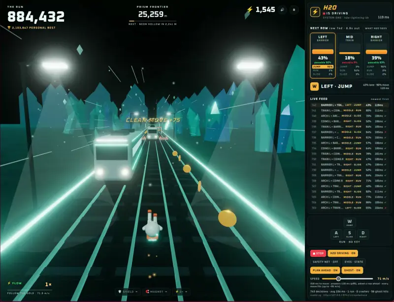

# Jevrunner

[](LICENSE)
[](https://huggingface.co/h2oai/h2o-lightning-4b)


**An endless runner driven live by a decision model running on your own machine.** H2O Lightning 4B, an open-weight
Jev-style model, reads the track and picks a lane and a move for every row of obstacles. The panel on the right shows
each decision as it happens: the odds per lane and per move, the keys it "presses", and how long it took.



This repo is a hands-on way to learn three things:

- **what a Jev-style decision model is**: it doesn't write text, it picks one of the options you give it and returns a
  probability for each, in one forward pass;
- **how to host one yourself**: H2O Lightning 4B on vLLM or llama.cpp, on Linux, Windows or macOS, from a 4 GB GPU up;
- **how to put one in a real-time loop**: a game asks it a question every ~0.5 s, and you watch accuracy, latency and
  the tricks that make them work together.

## Quick start

You need [Node.js 22+](https://nodejs.org), [Python 3.10+](https://www.python.org/downloads/) and Git. Setup picks
the right way to run the model for your machine ([which one](#which-backend-you-get)), downloads it once into
`~/.jevrunner`, and `run` starts the model, then the game at **http://localhost:5175**. Press **▶ LET H2O RUN**.

**Linux and macOS** (on a Mac, `brew install node python git` installs what's needed)

```bash
git clone https://github.com/SolvAI/Jevrunner && cd Jevrunner
scripts/setup.sh
scripts/run.sh
```

**Windows** (PowerShell)

```powershell
winget install OpenJS.NodeJS.LTS; winget install Python.Python.3.12; winget install Git.Git   # if needed, then open a new terminal
git clone https://github.com/SolvAI/Jevrunner; cd Jevrunner
powershell -ExecutionPolicy Bypass -File scripts\setup.ps1
powershell -ExecutionPolicy Bypass -File scripts\run.ps1
```

**Small GPU (4–6 GB)?** Use the 2.7 GB model: copy `config.example.env` to `config.env` and set `QUANT=Q4_K_M`
before setup (add `SLOT_CTX=4096` on a 4 GB card). It runs in ~3.4 GB, and on this game it made the same decisions as
the full model (940/940 rows). In H2O's own tests it changes about 1 answer in 18, so H2O still labels it
experimental.

Ctrl-C stops the game and the model (`KEEP_H2O=1` leaves the model running for next time; `scripts/stop_h2o.sh` or
`scripts\stop.ps1` stops it). Already have the model downloaded? See `config.example.env`.

### Which backend you get

| your machine | backend | model download | GPU memory | one decision* | rows passed* |
|---|---|---|---:|---:|---:|
| Linux + NVIDIA GPU 15 GB+ (the default there) | vLLM 0.30.0, two-way reading | 9.3 GB (BF16) | ~14 GB | **~90 ms** | 600/600 |
| any other GPU: Windows, macOS (Metal), Linux (CUDA, Vulkan) | llama.cpp | 4.5 GB (Q8_0) | ~5.1 GB | ~240 ms | 300/300 |
| a small GPU, `QUANT=Q4_K_M` | llama.cpp | 2.7 GB (Q4_K_M) | ~3.4 GB | ~230 ms | 940/940 |
| no GPU (`NGL=0`, or no GPU found) | llama.cpp on the CPU | 2.7 GB (Q4_K_M) | – | ~2.1 s | 80/80 |

\* measured on an RTX 4090 (24 GB) and, for the CPU row, its 28-core host, with `npm run sim`: one decision is 7
questions in 4 parallel requests. `BACKEND=llamacpp` (or `vllm`) in `config.env` overrides the choice.

- **On llama.cpp**, answers take ~0.25 s instead of ~0.1 s, so the game turns **PLAN AHEAD** on by itself (see
  [timing](#timing-and-how-fast-it-can-go)). With it, at the default 34 m/s, Q8_0 drove 3 km and Q4_K_M 2 km
  without a crash; without it, Q8_0 crashed after 2 km. You can still switch it off.
- **On the CPU only**, play at the slowest speed (15 m/s) with PLAN AHEAD: a decision then has ~3 s to arrive, and
  answers take 2–3 s, so expect an occasional late one.
- The llama.cpp builds are H2O's official GGUF files, v1.2.x weights with one-way reading (vLLM serves v1.3, two-way).
  Setup downloads a prebuilt llama.cpp for your OS and GPU (CUDA for NVIDIA, Vulkan for AMD and Intel, Metal on Macs),
  then H2O's own llama.cpp shim, and checks every file against its published SHA-256. Nothing is compiled.
- **Windows with an NVIDIA GPU, and want vLLM's speed?** Install [WSL2](https://learn.microsoft.com/windows/wsl/install)
  with Ubuntu, then follow the Linux steps inside it; open http://localhost:5175 in your Windows browser.
- **Mac with Apple Silicon, MLX instead of llama.cpp?** The community
  [h2o-lightning-mlx](https://github.com/internet-projects/h2o-lightning-mlx) serves the model with MLX on the same
  port: run its `./setup.sh q8` and `MODEL=mlx-q8 ./serve.sh`, then `scripts/run.sh` here sees it and starts the game.

Tested here: Linux with vLLM, and Linux with llama.cpp on CUDA and on the CPU. The Windows and macOS scripts follow
the same steps (they share `scripts/llamacpp.py`) but haven't been run on those systems yet. If something breaks there,
please open an issue.

## Playing

| | |
|---|---|
| **LET H2O RUN** | start; after a crash the next run starts by itself |
| **H2O DRIVING** | off: you drive with A D (lanes), W (jump), S (slide) |
| **SPEED** | 15–200 m/s, applied at once |
| **PLAN AHEAD** | H2O decides one row ahead (see [timing](#timing-and-how-fast-it-can-go)) |
| **GHOST** | a hit is counted, but the run goes on |
| **SAFETY NET** | replaces a move of H2O's that would crash with the right one before it happens, counted as "net" |
| **EYES · SCREEN** | H2O gets the game's frame (an image) instead of the track as text |
| **WHAT H2O SEES** | the exact requests and answers of the last decision |
| keys | P pause, M sound, F frame rate |

URL options: `?autoplay`, `?speed=90`, `?plan`, `?ghost`, `?vision`, `?net`.

## How it works

### The model's side: System One

A Jev-style model (TypeSafe's Jev and its open-weight cousins) answers **typed questions about a state**. You send a
state (text, JSON, images) and questions, each with its options. You get back a probability for every option:

```jsonc
// POST http://127.0.0.1:8741/v1/systemone
{
  "state": { "lane": "mid", "row": 25, "in_lane": "an overhead arch: passable only by sliding" },
  "questions": {
    "mid_move": {
      "type": "choice",
      "instructions": "In the mid lane, row 25 has an overhead arch: passable only by sliding. Which move gets the runner through it?",
      "criteria": {
        "jump": "Jump: gets over a low barrier",
        "run": "Run: gets through a free lane, coins or a power-up",
        "slide": "Slide: gets under an overhead arch"
      }
    },
    "mid_safe": { "type": "noul", "instructions": "The runner can get through row 25 in the mid lane (with the right move)." }
  }
}
// H2O's answer (rounded), in 56 ms:
// {"mid_move": {"choice": "slide", "probabilities": {"jump": 0.02, "run": 0.02, "slide": 0.96}},
//  "mid_safe": {"noul": 0.89}}
```

`choice` picks one option, `noul` is a yes/no, and `score` (not used here) is a level on a scale. H2O Lightning 4B is a
4B model (Qwen3.5-4B, fine-tuned by H2O.ai). Its own small server, the shim, turns these requests into one model pass
per question, on vLLM (`scripts/serve_h2o.sh`) or on llama.cpp (`scripts/llamacpp.py serve`). Both answer the same
API on the same port, so the game doesn't know which one it talks to.

### The game's side: two inferences per row

Every 34 m there is a row of obstacles: per lane, nothing, coins, a power-up, a **low barrier** (jump), an
**overhead arch** (slide) or a **train** (change lanes). For each row the game asks:

1. **lane**: left, mid or right? This question sees the whole state (the runner's lane, the row, the two rows after).
2. **move**, per lane: jump, run or slide? Plus **passable**, a yes/no. These questions see only their own lane.

That's 7 questions in 4 parallel requests, about 90 ms in all. The lane taken is the one with the best
`P(lane) × P(passable)`, and the move is that lane's likeliest. Every request and answer is in
`runs/decisions-<date>.jsonl`, and **WHAT H2O SEES** shows them live.

The question design is most of the work. Measured with `npm run sim` (the rows without the game):

| how the questions were asked | rows passed |
|---|---:|
| all questions in one request, about the whole track | 90% |
| clearer option wording | 97% |
| each move question sees only its own lane | 99% |
| plus the "passable" yes/no per lane | **100%** (600/600) |

With the whole track in view, H2O drifted to "run" on the move questions. Asked about one lane alone, it got
300/300 right.

### Timing, and how fast it can go

The game asks about a row once the row before it is a train's length behind. That leaves 22 m for the answer and
the move. Switching lanes takes 71 ms for one lane and 213 ms for two. With answers at ~110 ms:

| move | fits up to | with PLAN AHEAD |
|---|---:|---:|
| a two-lane escape | ~65 m/s | ~95–100 m/s |
| a one-lane dodge | ~110 m/s | ~250 m/s |
| a jump or slide in place | ~130 m/s | ~380 m/s |

**PLAN AHEAD** asks about the next row as soon as the last answer is in, starting from the lane that answer chose,
and holds the move until its turn. The answer's time then no longer has to fit in front of the row.

Measured, crashes in 90 s: 80 m/s, 10 without plan-ahead and 1 with it; 100 m/s, 13 and 0 (9 km without a crash);
130 m/s, 9 with plan-ahead, all two-lane switches. H2O made no wrong call at any speed: every crash was a right
decision the runner couldn't finish in time. At the default 34 m/s, H2O drove 6 km in 3.5 minutes without a crash.
The panel's speed readout does this arithmetic live with your measured latency.

### Text or pictures?

By default H2O reads the track as structured text taken straight from the game. That's how Jev-style models control
games today: game state as compact JSON, not screenshots. **EYES · SCREEN** sends the actual frame instead
(H2O Lightning 4B reads images). It stays fast (~140 ms), but in a first test it crashed 3 times in a minute against
none in 6 km on text.

## Other models

The game talks to any System One endpoint. Set `DECIDE_URL` in `config.env` (and `MODEL_LABEL` for the panel), plus
`DECIDE_KEY` and `DECIDE_MODEL` for a hosted one, then `scripts/run.sh` starts only the game. Only H2O Lightning 4B's
own shim has been tested; a hosted API may differ in details (images, for example).

## Hosting notes

**vLLM** (`scripts/serve_h2o.sh`) runs the model's own `serve.sh`, sized for this game: an 8,192-token context, 32
requests at a time, and 60% of the GPU (~14 GB on 24 GB). That leaves room for the browser, which draws the game on
the same GPU. At the model's own defaults (40,960 tokens, 256 requests) vLLM's start-up wants ~22 GB. On a 16 GB
card, set `GPU_UTIL=0.85` in `config.env` and keep other GPU-heavy apps closed.

**llama.cpp** (`scripts/llamacpp.py`) starts llama-server with the flags of H2O's own launcher: its Qwen2 tokenizer
override and no unified KV cache. It uses one 8,192-token slot: llama.cpp runs this model's requests one after
another anyway, and with 4 slots a decision took longer (267 ms against 229 ms) in more memory. It also turns off
llama-server's host-RAM prompt cache, which saves ~100 MB of state before every request and here only cost time (481
against 267 ms per decision with 4 slots).
At start-up, H2O's shim checks 24 tokenizer probes against the backend and refuses to answer if one differs. H2O's own
one-command launcher is Linux-only and builds llama.cpp from source; this one downloads prebuilt builds instead,
pinned to llama.cpp `b11707`. `LLAMA_SERVER` in `config.env` uses a llama-server you already have.

## Troubleshooting

- **`CUDA out of memory` while H2O starts on vLLM.** Lower `GPU_UTIL` or `MAX_LEN` in `config.env`, close GPU-heavy
  tabs, or switch to the smaller model: `BACKEND=llamacpp` and `QUANT=Q4_K_M`. The shim needs `MAX_LEN` ≥ 4096.
- **`There is no module or parameter named 'W'`.** vLLM read `label_rows.safetensors` (from a download made before
  2026-10-17) as weights. Start H2O through `scripts/serve_h2o.sh`, which hides that file from vLLM.
- **"model DOWN" under the panel's buttons.** H2O isn't running, or is still starting. Its log is
  `~/.jevrunner/logs/h2o.log` (on llama.cpp also `llama-server.log` and `shim.log` next to it).
- **llama.cpp runs on the CPU although you have a GPU.** Look at `llama-server.log` for the devices found. Set
  `LLAMA_BUILD=vulkan` (or `cuda`) in `config.env` and run setup again; on NVIDIA, update the driver.
- **Windows: "running scripts is disabled".** Start them as shown above, with `powershell -ExecutionPolicy Bypass -File`.
- **Windows: Python opens the Microsoft Store.** That's Windows' placeholder: install Python
  (`winget install Python.Python.3.12`) and open a new terminal.
- **macOS: llama-server is blocked by Gatekeeper.** Run `xattr -dr com.apple.quarantine ~/.jevrunner/llama.cpp`.
- **Port in use.** Another H2O or game is running: `scripts/stop_h2o.sh` (`scripts\stop.ps1`), or set `H2O_PORT` or
  `GAME_PORT`.
- **Choppy frames.** Press F. The resolution drops by itself when frames run long, and H2O shares the GPU.

## The project

```
scripts/setup.sh, run.sh       install once, then start everything (Linux, macOS)
scripts/setup.ps1, run.ps1     the same on Windows; stop.ps1 stops the model
scripts/serve_h2o.sh           H2O Lightning 4B on vLLM, sized for the game; stop_h2o.sh stops it
scripts/llamacpp.py            H2O Lightning 4B on llama.cpp, any OS: setup (prebuilt llama.cpp, GGUF, verified), serve
scripts/sim.mjs                the rows without the game: H2O's accuracy and latency (npm run sim)
server/decide.js               the game's server: forwards decisions to the model, times and logs them (a Vite plugin)
src/world.js                   the rules, the track, the questions, the readout
src/game.js                    a run, and the Driver (the model at the wheel, plan-ahead, safety net)
src/scene.js, sky.js, runner.js, props.js, fx.js   the three.js world, all made of shapes
src/ui.js, main.js, audio.js   the panel and HUD, the wiring, the synthesised sound
tests/                         npm test
```

## Credits

- [H2O Lightning 4B](https://huggingface.co/h2oai/h2o-lightning-4b) and its
  [GGUF builds](https://huggingface.co/h2oai/h2o-lightning-4b-gguf) by H2O.ai (Apache-2.0): the model and its shims.
  They are downloaded at setup, not part of this repo.
- [llama.cpp](https://github.com/ggml-org/llama.cpp) (MIT) and [vLLM](https://github.com/vllm-project/vllm)
  (Apache-2.0) run the model. The MLX route for Macs is NetProjects'
  [h2o-lightning-mlx](https://github.com/internet-projects/h2o-lightning-mlx).
- Jev and the System One API by [TypeSafe](https://typesafe.ai): the decision-model idea this is built around.
- Inspired by the "Jev drives Astra Surfers" demo shared on X by
  [@_MaxBlade](https://x.com/_MaxBlade/status/2100634359099232678). That game is its author's own; this is a fresh
  build in the same spirit.
- [three.js](https://threejs.org) and [Vite](https://vite.dev) (MIT). The fonts Oxanium and Rajdhani come from
  Google Fonts (OFL).

## License

[MIT](LICENSE).
